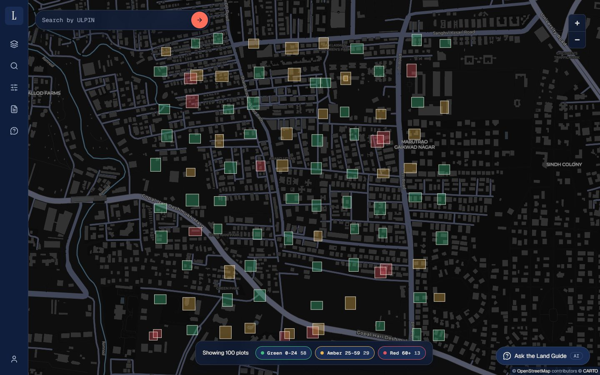
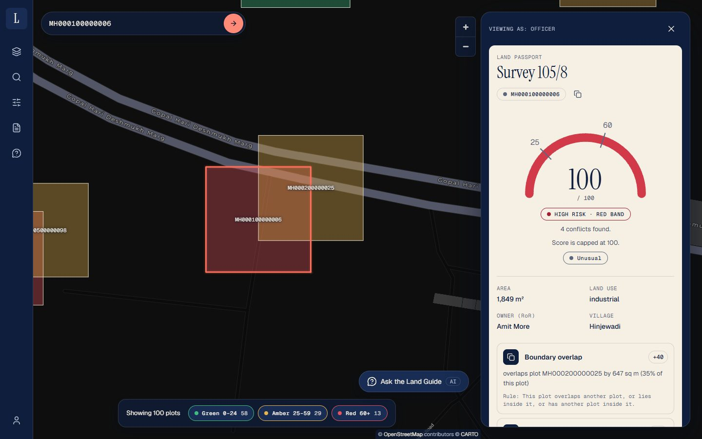
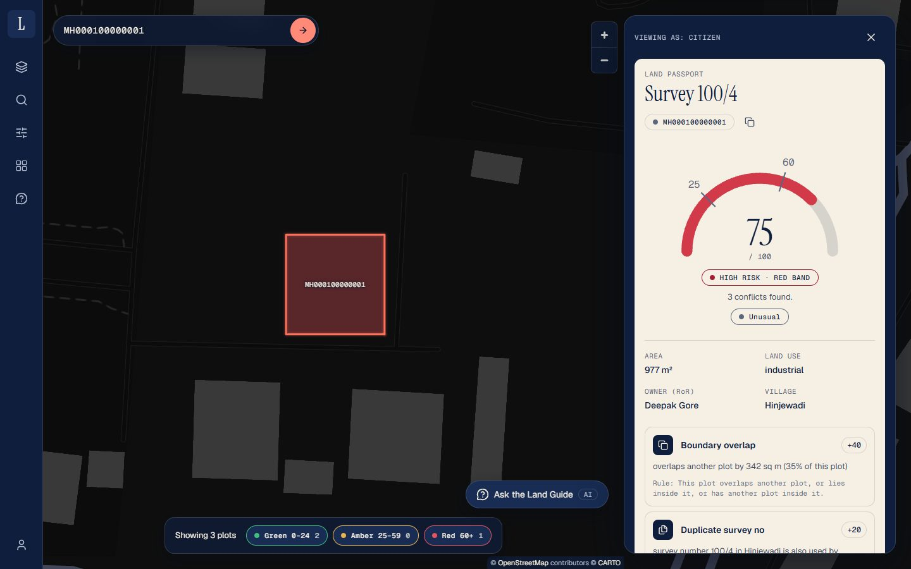
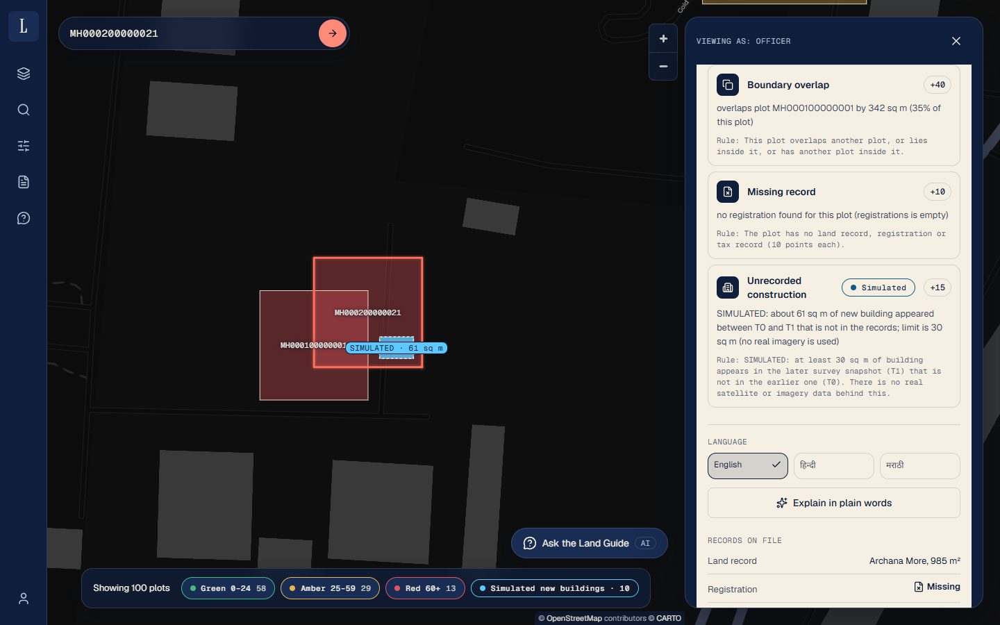
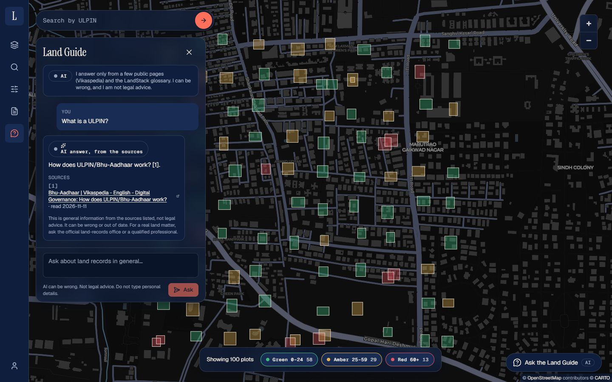
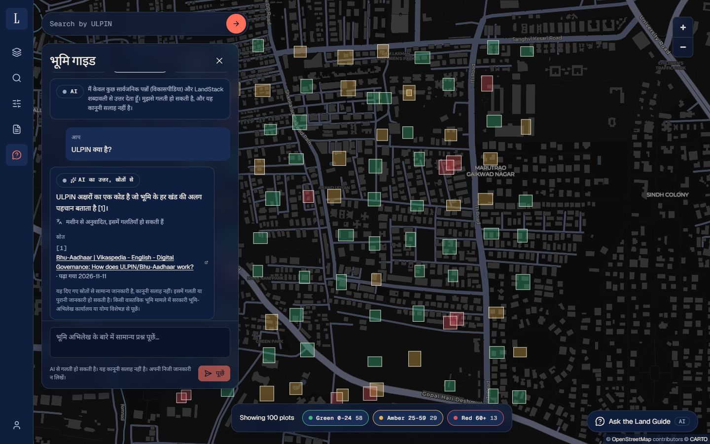
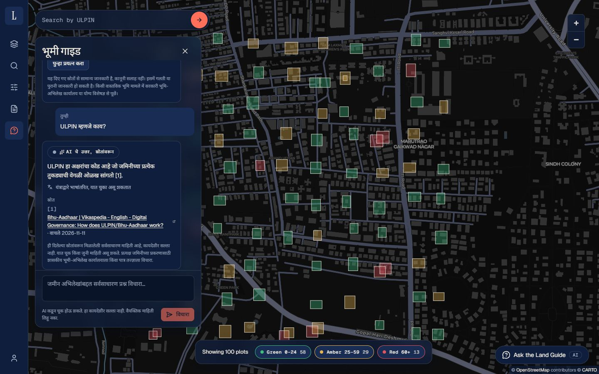
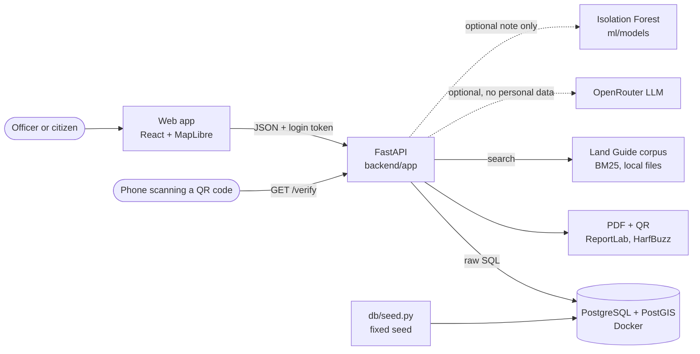

# LandStack

**Land records on a map: it finds conflicts between a plot's boundary, its land record, its registration and its tax record, gives each plot a risk score from fixed rules, and prints a one-page "land passport" that anyone can verify by scanning its QR code.**

A student portfolio project, built on **fake data** near Pune. It is a demo, not an official or legal tool.
Credit: the **LandStack SIH 2026 team** (the project started under that name).



## Screenshots

| | |
|---|---|
|  **Land passport.** Score, findings with evidence and rules. |  **Citizen view.** A citizen sees only their own plots; the plot they overlap is neither named nor drawn. |
|  **Construction switch.** New-building outlines, labelled SIMULATED (there is no real imagery). |  **Land Guide.** Answers only from a few public pages, with links. *(Made with a local stand-in model, so the wording is not a real model's.)* |
|  **हिन्दी.** Machine-translated, and labelled so. |  **मराठी.** Same. |

More: [login screen](docs/screenshots/01-login.jpg), [phone passport](docs/screenshots/06-phone-passport.jpg), [sample PDFs](docs/samples/), and the guided tour in [docs/DEMO.md](docs/DEMO.md).

## What it does
- **Shows 100 demo plots on a map**, coloured by risk band, with filters, search by ULPIN (a plot's 14-character id) and light, dark and satellite basemaps.
- **Runs nine conflict checks** in PostGIS (overlaps, restricted zones, area, owner name, duplicate survey number, invalid shape, overdue tax, missing record, and a *simulated* unrecorded-construction check). The SQL is visible in `backend/app/checks.py`: no ORM.
- **Scores each plot** with fixed points (below) and shows a **land passport**: every finding with its evidence and the rule that raised it.
- **Prints a one-page PDF passport** with a QR code and a short document id. **`/verify`** tells anyone, on a phone or through the API, whether the records still match what was printed.
- **Has roles**: admin, officer (see every plot) and citizen (see only their own; anything else is "not found"). Logins and downloads are audit-logged; there are rate limits.
- **Optional AI helpers** (off unless you add a key): "Explain in plain words" rewrites a plot's findings in words; the **Land Guide** answers general questions from a small set of public pages. Both can work in हिन्दी and मराठी. **The AI never changes a score.**
- **A statistical "unusual plot" note** from an Isolation Forest model: a hint for a human, never part of the score.
- **State adapters** turn three made-up state formats into one standard format (square metres, ISO dates, "Given Family" names).

## How the risk score works
**The score is computed by code only.** Models and LLMs never add, remove or change a point, a finding or a band. The points are in `backend/app/config.py`:

| Finding | Points | Raised when |
|---|---|---|
| Boundary overlap | 40 | the plot overlaps another plot, lies inside one, or holds one (at least 5 sq m shared) |
| Restricted zone clash | 30 | more than 20% of the plot is inside a restricted zone |
| Area mismatch | 25 | the recorded area is more than 10% away from the mapped area (measured in square metres with a geography cast) |
| Owner mismatch | 25 | the land-record owner and the registration owner are not the same person (name match below 0.60) |
| Duplicate survey number | 20 | another plot in the same village has the same survey number |
| Invalid boundary | 15 | the shape is invalid (for example it crosses itself) |
| Tax overdue | 15 | tax was last paid more than 2 years before 1 Jan 2026 |
| Unrecorded construction (**simulated**) | 15 | at least 30 sq m of building appears in the later generated snapshot (T1) that is not in the earlier one (T0) |
| Missing record | 10 each | no land record, registration or tax record |

The points add up and **stop at 100** (the passport says "Capped at 100" when they would have gone over). **Green 0 to 24, amber 25 to 59, red 60 and above.**
Invalid shapes are skipped by the overlap and zone checks (they get their own finding). Every check has a pytest test that compares the result with `db/planted_truth.json`, the list of problems the seed planted on purpose.

## Architecture


## Tech stack
- **Backend:** Python 3.14, FastAPI, psycopg 3 with hand-written SQL, PostgreSQL 16 + PostGIS 3.4 (Docker), argon2 and JWT for login, slowapi for rate limits, ReportLab, qrcode, pypdf, HarfBuzz (`uharfbuzz`) and fontTools for Devanagari in the PDF.
- **ML and AI:** scikit-learn (Isolation Forest), SHAP, rank_bm25 + BeautifulSoup (Land Guide), OpenRouter (optional).
- **Frontend:** React 19, TypeScript, Vite 8, Tailwind CSS 4, MapLibre GL, framer-motion, GSAP (one number animation), self-hosted fonts.
- **Tests and CI:** pytest, a design-rule checker (`npm run check:design`), GitHub Actions.

## Quick start
You need **Docker** (running), **Python 3.14** (what the exact pinned versions were tested on; 3.11 to 3.13 may work if every pinned package has a wheel for it) and **Node 20.19 or newer** (24 was tested). About 10 minutes.

**1. Clone and run the setup script.** It writes a `.env` with random secrets (only if you have none), starts the database, installs the packages, creates the schema, seeds the fake data and the demo users, builds the Land Guide corpus (6 public pages, downloaded politely, about 30 seconds) and runs the checks.

Windows PowerShell:
```powershell
git clone https://github.com/ved-1446/landstack.git
cd landstack
powershell -ExecutionPolicy Bypass -File scripts\setup.ps1
```
Linux or macOS:
```bash
git clone https://github.com/ved-1446/landstack.git
cd landstack
bash scripts/setup.sh
```
Useful options: `-Yes` / `--yes` (do not ask before re-creating tables), `-SkipCorpus` / `--skip-corpus` (no download), `-SkipFrontend` / `--skip-frontend`.

> **The schema step deletes data.** `db/schema.sql` drops and recreates every table. On a fresh clone there is nothing to lose. If the database already has LandStack tables, the script says so and asks you to type `YES` first.

**2. Start the API** (terminal 1, from the repo root):
```powershell
.venv\Scripts\python.exe -m uvicorn backend.app.main:app --reload     # Windows
```
```bash
.venv/bin/python -m uvicorn backend.app.main:app --reload             # Linux / macOS
```
API docs: <http://localhost:8000/docs>.

**3. Start the web app** (terminal 2):
```
cd frontend
npm run dev
```
Open <http://localhost:5173> (the port is fixed because the API only accepts requests from the origins in `CORS_ORIGINS`, default `http://localhost:5173`).

Then follow the 8-click tour in [docs/DEMO.md](docs/DEMO.md).

**Doing it by hand** (what the script does): copy `.env.example` to `.env` and fill it in; `docker compose up -d`; `python -m venv .venv`, activate it, `pip install -r backend/requirements.txt`; apply `db/schema.sql` (`Get-Content db/schema.sql | docker exec -i landstack-db psql -U landstack -d landstack -v ON_ERROR_STOP=1`; on Linux/macOS use `< db/schema.sql`); `python db/seed.py`; `python db/seed_users.py`; `python -m chatbot.build`; `python -m backend.app.checks`; `cd frontend && npm ci`. Details for every part are in [docs/REFERENCE.md](docs/REFERENCE.md).

### The legacy names: `landstack-db`, `landstack`, `landstack`
The project began as **LandStack**. The Docker container is named `landstack-db`, and the PostgreSQL database and its user are both `landstack`. These **legacy infrastructure names were kept on purpose**: Postgres reads its user and database name only when a data volume is first created, so renaming them in `docker-compose.yml` would not rename an existing database and would break any machine that already has one. Everything a reader sees (the app, the PDF, the API docs, this file) says LandStack. Two variables let a second copy run beside the first: `LANDSTACK_DB_CONTAINER` (container name) and `POSTGRES_PORT`. Set them in your shell before the setup script (or in `.env`) if `5432` or the container name is already taken. `backend/app/db.py` and `db/seed.py` carry a comment pointing here.

### Settings (`.env`, never committed)
`.env.example` lists every variable with no real values. The important ones:

| Variable | What it does |
|---|---|
| `POSTGRES_PASSWORD` (and `POSTGRES_USER`, `POSTGRES_DB`, `POSTGRES_HOST`, `POSTGRES_PORT`) | the database |
| `JWT_SECRET` | login-token key. **The server refuses to start without a long random one** and rejects the placeholder |
| `CORS_ORIGINS` | web addresses allowed to call the API (comma separated, **no wildcards**; a bad value stops the server) |
| `PUBLIC_BASE_URL` | where the QR code on a printed passport points |
| `OPENROUTER_API_KEY`, `OPENROUTER_MODEL` | optional: turn on the AI helpers (a free model is fine) |
| `VITE_API_URL`, `VITE_DEMO_ACCOUNTS`, `VITE_CARTO_KEY`, `VITE_ESRI_KEY` | web app (`frontend/.env`): see below |

Optional **free basemap keys**: the Light and Dark maps use a keyless CARTO address that works today but may stop; a free CARTO key in `VITE_CARTO_KEY` and an Esri API key in `VITE_ESRI_KEY` (satellite) make them dependable. Without keys the app still runs.

## Demo accounts
**These passwords are public. Never use them anywhere real.**

| Username | Password | Role | Sees |
|---|---|---|---|
| `admin` | `AdminDemo#2026` | admin | everything an officer sees, plus the audit log |
| `officer` | `OfficerDemo#2026` | officer | all plots and passports |
| `citizen1` | `Citizen1Demo#2026` | citizen | only its 3 plots |
| `citizen2` | `Citizen2Demo#2026` | citizen | only its 3 plots |

The login screen shows these as one-click buttons **only when `VITE_DEMO_ACCOUNTS` is exactly `true`** in `frontend/.env` (the setup script writes that for local demos). **Warning: the row shows usernames and passwords on the login screen. It is off by default; never set it to `true` in a real deployment**, and build a production copy with it unset (`npm run build`).

## Tests
```
python -m pytest backend/tests -q        # 659 tests; needs the database running and seeded
cd frontend && npm run check:design      # design rules: no stray colours, sizes, emoji or old product name
cd frontend && npm run build             # design check + TypeScript + production build
```
The tests use a throw-away JWT secret, switch the AI **off** and block the network, so they never call OpenRouter or any website. GitHub Actions runs the same three things on every push (`.github/workflows/ci.yml`, Python 3.14, a PostGIS service container, no secrets).

## Honesty: what this is not
- **The data is fake.** 100 generated plots near Pune, with problems planted on purpose by `db/seed.py` (same seed, same data). Every number in the demo is demo data. PDFs say so.
- **The three state formats are made up.** The Maharashtra (CSV), Karnataka (JSON) and Uttar Pradesh (nested JSON) formats were invented for the demo. They are not the real formats of those states' systems.
- **Change detection is simulated.** There is no satellite or aerial imagery. The two building "snapshots" are generated by the seed script. The words SIMULATED appear on purpose in the app, API docs and PDF.
- **The ML model mostly relearns the generator.** It is an Isolation Forest trained on 5,000 *generated* plots and measured on 2,000 other generated plots (160 with a planted problem, 8.0%). Flagging the top 5% (the cut-off in use) catches 51 of those 160 problem plots (31.9%) and wrongly flags 53 of 1,840 clean ones (2.9%): precision 49.0%, about 6.1 times better than flagging at random. It catches **every** overlap, but only because in the generated map plots never touch unless an overlap was planted; it catches **none** of the plots whose only problem is an owner mismatch (0 of 18), a duplicate survey number (0 of 25) or a missing record (0 of 12). These figures are from a re-run of `python -m ml.evaluate`. They say nothing about real land records, and the note is advice for a person, never part of the score.
- **The name matcher barely improved.** On 600 rule-made name pairs (240 held out for testing), tuning the matcher's threshold raised F1 by only **+0.008** (0.855 to 0.863), below the +0.02 the project asked for, so **the threshold stays at 0.60**. It still misses names written as an initial, a spelling variant and an honorific (`Anita Joshi` vs `Mrs Joshee A.`) and wrongly matches near-identical different names (`Vijay Lokhande` vs `Vinay Lokhande`).
- **The Land Guide's corpus is small:** 53 passages from 6 public Vikaspedia pages plus a glossary written for this project. Many questions get "I don't know from my sources." The pages are a snapshot and can be old. It can be wrong and it is not legal advice.
- **Translations are machine-made.** Hindi and Marathi answers come from translating the checked English answer with a free model and are labelled "machine-translated, may contain errors". The fixed Hindi and Marathi sentences in `chatbot/strings.json` were written by a person (not by an AI each time) but **have not been reviewed by a native speaker**. Only the Land Guide panel and the Explain section are translated, not the whole app.
- **Login tokens cannot be revoked.** They are standard JWTs that last 60 minutes by default. Logging out only forgets the token in the browser; a stolen token works until it expires. The rate-limit counters live in the server's memory (they reset on restart and are not shared between workers).
- **Whatever you send to the AI leaves your machine.** The app sends as little as it can (finding types, numbers, the question; no names, no ULPINs). Do not type personal details into the Land Guide.
- **No security audit.** The dependency audits (`pip-audit`, `npm audit`) were clean when run, secrets are not in the repository or its history, and citizens cannot reach other people's plots on any endpoint (a test walks every endpoint). That is not a substitute for a real review before any real use.

### Plan: how a real deployment would train and ship the ML model
Nothing below is built; it is the plan.
1. **Train on real, approved records, not generated ones**, and re-measure with a person labelling a sample. If it does no better than luck on real data, drop the note.
2. **Keep the feature code in one place** (`ml/features.py`, already shared by training and the API) and refuse a model whose feature list or scikit-learn version differs (already enforced: the API then starts without the note).
3. **Train in a controlled job** (for example a scheduled CI job), not on a laptop, and store the model file outside the repository (it is git-ignored) in private storage.
4. **Treat the model file as code.** `.joblib` is Python pickle and runs code when loaded: only load files your own job produced, from a read-only location, ideally checked against a stored hash, or switch to a data-only format.
5. **Retrain on a schedule and watch for drift** (the share of plots flagged, compared with the training share of 5%).
6. **Cache the features.** Today each passport request rebuilds the features for every plot, which is fine for 100 plots but not for a state.

## Credits
- The **LandStack SIH 2026 team**, where this project began.
- **ThreeUI** (Meng To): the *Flow Field* login background, MIT licence (<https://github.com/MengTo/threeui>). Notice in [THIRD_PARTY.md](THIRD_PARTY.md).
- **Vikaspedia**, C-DAC Hyderabad, Ministry of Electronics and Information Technology, Government of India: the public pages the Land Guide answers from (credited with a link in every answer; listed in `chatbot/sources.json`).
- **Noto Sans Devanagari** (The Noto Project Authors), **Geist** (The Geist Project Authors) and **Instrument Serif** (The Instrument Serif Project Authors), all SIL Open Font License 1.1.
- Map data © OpenStreetMap contributors, © CARTO; satellite imagery by Esri, Maxar, Earthstar Geographics and the GIS User Community.
- All other libraries and their licences are in [THIRD_PARTY.md](THIRD_PARTY.md). LandStack itself is MIT-licensed ([LICENSE](LICENSE)).

## More documentation
[docs/DEMO.md](docs/DEMO.md) (tour) · [docs/REFERENCE.md](docs/REFERENCE.md) (every phase in detail: adapters, login, PDF, ML tables, AI features) · [docs/api-contract.md](docs/api-contract.md) · [docs/DESIGN_SYSTEM.md](docs/DESIGN_SYSTEM.md) · [docs/PROJECT_BRIEF.md](docs/PROJECT_BRIEF.md) · [docs/HANDOFF.md](docs/HANDOFF.md)

## Future work
Not built (by design, to keep each phase small):
- **Login-token revocation** (a logout that really ends a token; short-lived tokens plus refresh).
- **Frontend bundle size:** the production build is over 500 kB after minification; split the map and the Land Guide into separate chunks (and consider dropping GSAP, which does one animation).
- **API backlog:** `GET /zones` (so the restricted-zones layer can be drawn), a `source` field on each evidence item (which table the finding came from), and `GET /villages` plus taluka and district on plots.
- A **native-speaker review** of `chatbot/strings.json`, and translating the rest of the app.
- Real **state adapters** against real file formats, wired to the API (today they load files by command).
- **Real imagery** for change detection, instead of generated snapshots.
- The **ML plan above** (real data, controlled training, a safe model format, a feature cache).
- **More Land Guide sources** beyond Vikaspedia, only where terms or permission allow (DOLR is on hold).
